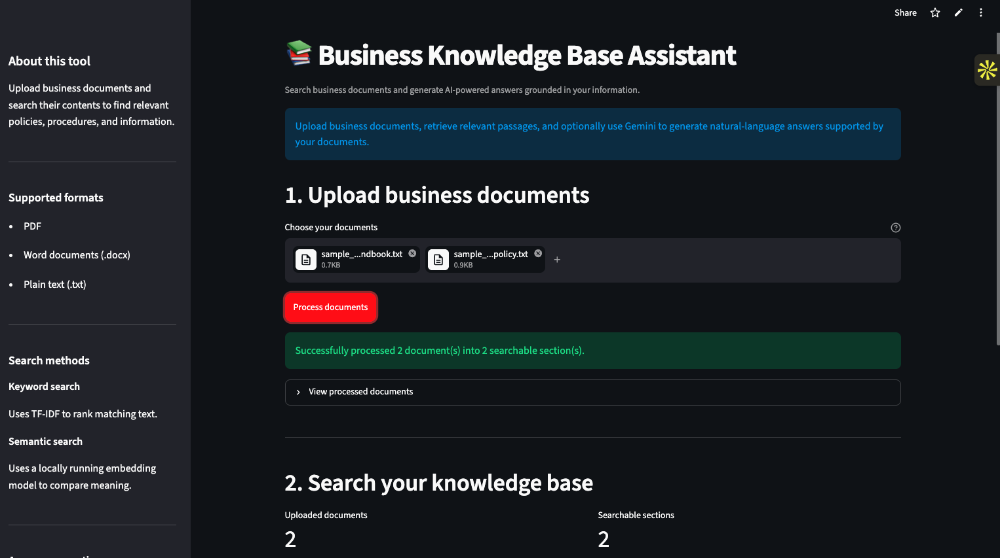
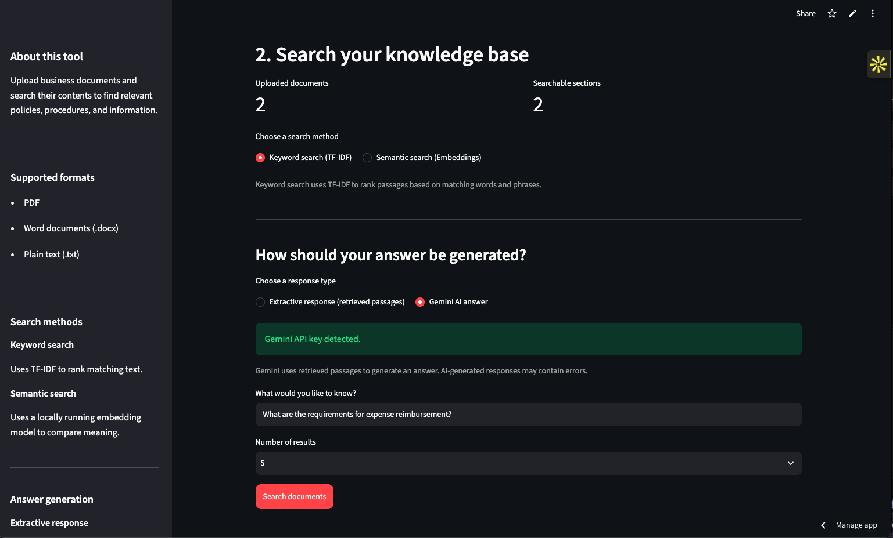
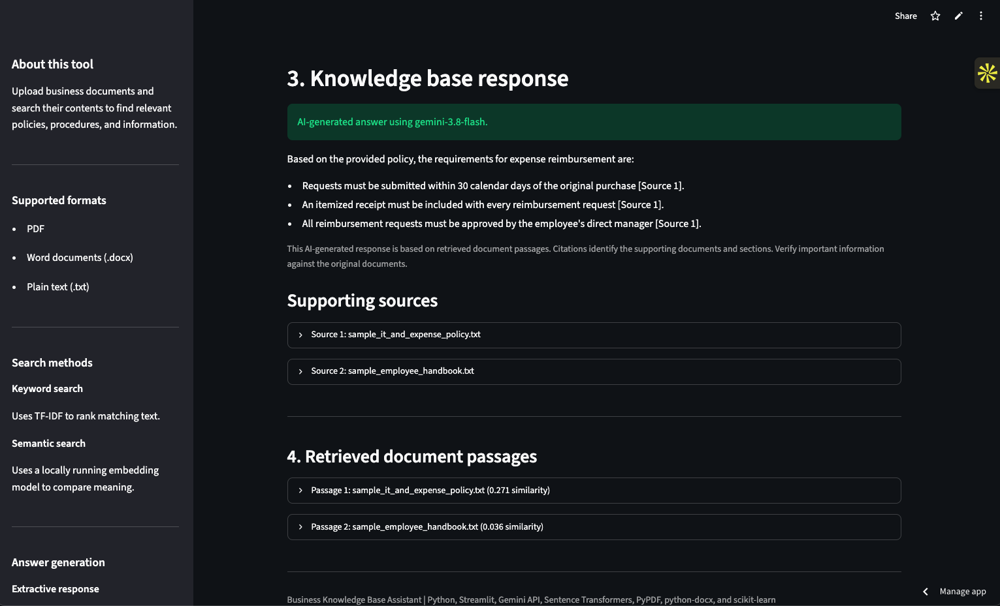
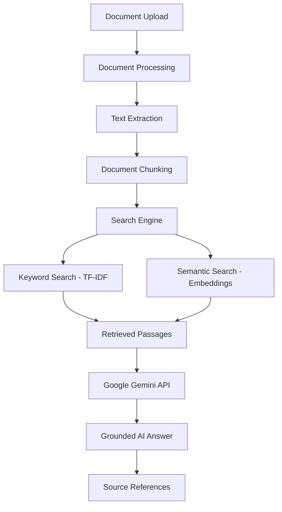

# Business Knowledge Base Assistant

[🚀 Live Demo](https://kfcuawpntcsnhawyco4zkw.streamlit.app/) | [GitHub Repository](https://github.com/RobertKoepp/business-knowledge-base-assistant)

[](https://github.com/RobertKoepp/business-knowledge-base-assistant/actions/workflows/tests.yml)

An AI-powered business document search and question-answering application built with Python, Streamlit, Sentence Transformers, and Google Gemini.

The application combines keyword search, semantic retrieval, and Retrieval-Augmented Generation (RAG) to help users find information across business documents and generate contextual answers with supporting source references.

## Application Screenshots

### Application Interface

Upload business documents, select a search method, and choose between extractive responses and Gemini-powered answers.



### Gemini AI Answer Generation

Gemini generates natural-language answers using relevant passages retrieved from uploaded documents.



### Supporting Sources and Document Retrieval

Answers include references to retrieved documents and the supporting passages used to generate the response.



## Overview

Businesses often store important information across employee handbooks, IT policies, expense procedures, and other documents. Finding specific information across these files can be time-consuming.

The Business Knowledge Base Assistant provides a centralized way to upload documents, search their contents, and ask questions using natural language.

Users can choose between keyword search, semantic search, extractive responses, and AI-generated answers using Google Gemini.

## Features

### Document Processing
- Upload PDF, DOCX, and TXT files.
- Extract text and organize content into searchable chunks.
- Preserve document names, page numbers, and section identifiers.

### Keyword Search
- Uses TF-IDF to rank passages based on matching words and phrases.
- Provides traditional keyword search without requiring an LLM.

### Semantic Search
- Uses Sentence Transformers and the all-MiniLM-L6-v2 embedding model.
- Converts document passages and user questions into vector embeddings.
- Uses cosine similarity to retrieve passages based on meaning.
- Supports configurable similarity thresholds.

### Gemini AI Answer Generation
- Integrates with the Google Gemini API.
- Generates natural-language answers using retrieved document passages.
- Includes source-number references in generated answers.
- Returns an insufficient-evidence response when retrieved content cannot answer a question.
- Checks that generated answers reference available source numbers.

### Reliability and Error Handling
- Falls back to retrieved document passages when Gemini experiences recognized temporary service errors or rate limits.
- Handles unsupported questions.
- Preserves extractive responses without requiring an API call.
- Includes automated tests for document processing, search, answer generation, and fallback behavior.

## How It Works

The application follows a Retrieval-Augmented Generation (RAG) workflow.



### Retrieval and Generation Process

1. Users upload business documents.
2. The document processor extracts and organizes the content.
3. The search engine retrieves passages relevant to the user's question.
4. Retrieved passages and source information are provided to Gemini.
5. Gemini generates an answer using the supplied document context.
6. The application checks that the answer references available source numbers and displays supporting passages.

The application also supports extractive responses, which display retrieved document passages without using an LLM.

## Technology Stack

| Technology | Purpose |
|---|---|
| Python 3.12 | Application development |
| Streamlit | Interactive web interface |
| Google Gemini API | AI answer generation |
| Google Gen AI SDK | Gemini API integration |
| Sentence Transformers | Semantic embeddings |
| all-MiniLM-L6-v2 | Embedding model |
| NumPy | Vector operations |
| scikit-learn | TF-IDF keyword search |
| PyPDF | PDF text extraction |
| python-docx | Word document processing |
| pytest | Automated testing |
| GitHub Actions | Continuous integration |

## Project Structure

```text
business-knowledge-base-assistant/
│
├── .github/
│   └── workflows/
│       └── tests.yml
│
├── assets/
│   ├── 01-app-interface.png
│   ├── 02-gemini-answer.png
│   └── 03-supporting-sources.png
│
├── app.py
├── document_processor.py
├── search_engine.py
├── semantic_search.py
├── answer_generator.py
├── llm_answer_generator.py
├── gemini_fallback.py
│
├── test_app.py
├── test_document_processor.py
├── test_search.py
├── test_search_modes.py
├── test_semantic_search.py
├── test_answer_generator.py
├── test_llm_answer_generator.py
├── test_gemini_fallback.py
│
├── sample_employee_handbook.txt
├── sample_it_and_expense_policy.txt
│
├── requirements.txt
├── .gitignore
└── README.md
```

## Installation

### Requirements

- Python 3.12
- pip
- A Google Gemini API key for AI-generated answers

### 1. Clone the repository

```bash
git clone https://github.com/RobertKoepp/business-knowledge-base-assistant.git

cd business-knowledge-base-assistant
```

### 2. Create a virtual environment

```bash
python3.12 -m venv .venv
```

Activate the environment on macOS or Linux:

```bash
source .venv/bin/activate
```

### 3. Install dependencies

```bash
python -m pip install -r requirements.txt
```

### 4. Configure the Gemini API key

Obtain an API key through Google AI Studio:

https://aistudio.google.com/apikey

Set the key as an environment variable:

```bash
export GEMINI_API_KEY="your-api-key-here"
```

Never commit API keys or other credentials to GitHub.

The Gemini API key is required for AI-generated answers. Keyword search, semantic search, and extractive responses do not require Gemini API access.

### 5. Run the application

```bash
python -m streamlit run app.py
```

Streamlit will provide a local URL where the application can be accessed.

The first semantic search may take longer because the embedding model needs to be downloaded and loaded.

## Live Deployment

The application is publicly deployed using Streamlit Community Cloud.

**Live Application:**  
https://kfcuawpntcsnhawyco4zkw.streamlit.app/

The deployed application uses Streamlit secrets for the Gemini API key. Credentials are not stored in the source code.

## Automated Testing

The project includes automated tests covering:

- Document processing and text extraction.
- Keyword search.
- Semantic search and retrieval.
- Extractive answer generation.
- Gemini answer generation.
- Insufficient-evidence handling.
- Application behavior.
- Temporary API failure and fallback behavior.

Run the complete test suite:

```bash
python -m pytest -q
```

Latest locally verified result:

```text
89 passed
```

GitHub Actions automatically runs the test suite when changes are pushed to the main branch or submitted through a pull request.

## Example Use Cases

The project includes fictional sample business documents covering employee policies, IT support, and expense reimbursement.

Example questions:

- How many vacation days do full-time employees receive?
- How far in advance must vacation be requested?
- Who should employees contact for technical support?
- What are the requirements for expense reimbursement?
- What is the company WiFi password?

Questions that cannot be answered using retrieved document passages should receive an insufficient-evidence response.

## Security and Limitations

- Gemini API credentials should be stored in environment variables or an approved secrets manager.
- Documents submitted for AI-generated answers are transmitted to the configured Gemini API. Do not upload confidential business information unless your data-handling arrangements authorize it.
- This application is a portfolio prototype and has not been validated for production use.
- Generated answers may contain errors or misinterpret document content.
- Citation-number validation confirms that referenced source identifiers exist. It does not independently prove every generated statement is supported by its cited passage.
- Semantic similarity scores represent retrieval relevance, not factual confidence.
- PDF extraction quality depends on document structure. Scanned documents may require OCR support.
- The application does not currently implement user authentication, role-based access, persistent document storage, or a production vector database.

## Future Improvements

- Chat-style interface and conversation history.
- Improved citation verification.
- Persistent vector storage.
- Multi-user access and authentication.
- Document management and deletion.
- Expanded evaluation using realistic business document collections.

## Author

Developed as an AI application and RAG portfolio project.

Demonstrates practical experience with Python application development, document processing, semantic retrieval, LLM integration, prompt design, automated testing, and AI reliability engineering.
